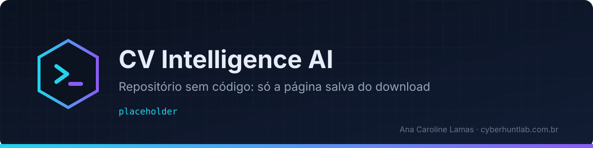

# CV Intelligence AI (arquivo incompleto)

Este repositório deveria conter o pacote **`cv-intelligence-ai.zip`**, mas o upload trouxe apenas a **página HTML salva da tela de download** (`cv-intelligence-ai.zip (1).html`), que mostra a mensagem "Preview is not available for this format". O ZIP e o código do projeto **não estão aqui**.

## Conteúdo

| Arquivo | Descrição |
|---|---|
| `cv-intelligence-ai.zip (1).html` | Página web salva (cerca de 14 KB), sem o conteúdo do ZIP |

## Projetos relacionados com código

- [ats-web](https://github.com/ticarollamas-arch/ats-web): otimizador web de currículos para ATS (Flask).
- [github-intelligence-career-ai](https://github.com/ticarollamas-arch/github-intelligence-career-ai): currículo, portfólio no GitHub e ideias para hackathons.
- [cyberhunterlab-funil-curriculo-github](https://github.com/ticarollamas-arch/cyberhunterlab-funil-curriculo-github): funil Currículo ATS → GitHub.

## Instalação e uso

Ainda não se aplica. Para publicar o projeto, envie o arquivo `cv-intelligence-ai.zip` original (ou o seu conteúdo extraído).

## Licença

Distribuído sob a licença MIT. Veja [LICENSE](LICENSE).
